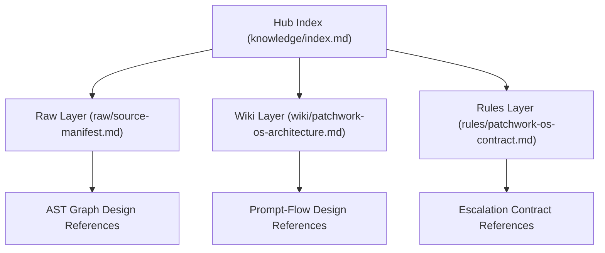

# Patchwork-OS: Local Python Workflow Evaluation Library

[](LICENSE)

**Patchwork-OS** provides Python workflow and contract APIs, plus repository-only architecture references and procedure skeletons. The initial evaluation scope is a local, nonsensitive sample. Workflow, Meta-Prompting, Graph-Prompting and Prompt-Flow describe the design vocabulary; they do not establish installed integrations or runtime enforcement.

## Local evaluation: install, use, remove

Python 3.11 or newer is required. Version 0.2.0 includes the local pwos command, loopback cockpit, public resources and an explicitly configured process backend. The earlier 0.1.1 review snapshot does not establish acceptance of this version.

Create an isolated virtual environment outside the checkout using `python -m venv .venv`. Using that environment's Python, install a locally reviewed wheel without an index or dependency resolution:

```text
python -m pip install --no-index --no-deps /path/to/patchwork_os-0.2.0-py3-none-any.whl
```

Initialize a nonsensitive directory with `pwos --root /path/to/workspace init`. Edit that workspace’s `.patchwork/config.json` to set the executable absolute path, argument array, delivery mode (`stdin` or `task_file`), and optional model and effort. Argument placeholders are `{model}`, `{effort}`, `{home}` and `{task_file}`. Use `doctor`, `run`, `status`, `collect`, and `close`; `serve` starts a loopback-only web cockpit. Terminal mode uses a persistent PTY; use `pwos input RUN_ID` to send stdin and `collect` to read the transcript. The web display preserves terminal text and ANSI sequences without emulating a full terminal. Exit status and transcript do not establish native Edit, model observation, or review acceptance.

The distributor needs a separately prepared build environment with setuptools>=68 to build the wheel. No build or installation command here represents company approval. Evaluate this Python example from a nonsensitive directory outside the repository:

```python
from hashlib import sha256
from pathlib import Path
from tempfile import TemporaryDirectory
from patchwork_os import plan_inter_cli_dispatch

with TemporaryDirectory() as directory:
    workspace = Path(directory)
    task = workspace / "task.md"
    task.write_bytes(b"Review a local nonsensitive sample.\n")
    plan = plan_inter_cli_dispatch(
        owner_session="local-evaluation",
        run_id="sample",
        target_runtime="codex",
        task_path=task,
        workspace_root=workspace,
        model_override="example-model",
    )
    assert plan["kind"] == "deploy2-cli-plan"
    assert plan["execution_supported"] is False
    assert plan["task"]["sha256"] == sha256(task.read_bytes()).hexdigest()
    assert plan["runtime_acceptance"] == "not_run"
    assert not Path(plan["run_dir"]).exists()
    assert not Path(plan["result_dir"]).exists()
    print(plan["kind"])
```

The API returns a plan dictionary. It does not launch an agent or create run/result directories. `launch_argv` is a descriptive compatibility template, not a supported command. `dry_run=False` raises `NotImplementedError`; a missing task raises `FileNotFoundError`, and a directory or other non-regular task raises `ValueError`. A real empty file is valid. `python -m patchwork_os.deploy_cli --help` is not a supported CLI; the observed baseline exited zero with no help output.

Only the `plan_inter_cli_dispatch` sample above is in this local evaluation. Other APIs are outside that sample: `bootstrap_agnostic_hub` writes project resources and can reach a Windows junction fallback; `safe_bind_spoke(..., allow_junction=True)` can invoke `cmd.exe /c mklink /J` when the directory symlink path fails on Windows; `build_deterministic_payload` can invoke `git diff` and `git status` when overrides are absent. `allow_junction=False` disables that junction branch, not every possible side effect, and does not bring these APIs into the evaluation scope. The existing default is unchanged. Runtime routing and setup/profile APIs also remain outside the sample and expose unverified example data, not assessed provider/compliance/model/cost guarantees.

Remove the package with the same environment's `python -m pip uninstall patchwork-os`. A pre-fix dedicated outside-repository venv observation recorded at 2026-10-28T04:02:20.302Z found both module and distribution metadata absent after uninstall. This does not verify removal of a wheel rebuilt after the current source changes. Deactivate and delete the dedicated venv if desired, and remove only sample files you created. Network egress and full isolation remain unmeasured.

The repository's `.claude/settings.json` is intentionally empty. Existing statusline commands and permission allow entries are preserved in the inactive `.claude/settings.example.json`. Reading that example does not enable it. Any later manual configuration requires separate review of the commands, helpers, permissions, and local policy; it is not part of this evaluation. Do not overwrite user/global settings or enable external AI, hooks, or permission bypass for the sample.

ITAR status, company authorization, upstream license clearance, complete isolation and authenticated/signed dispatch are unverified. Task/prompt hashes are integrity descriptors, not signatures or authorization.

## 1. Repository Document Topology



## 2. Five Pillars and Design References

This table preserves design references and intended counterpart coverage. Upstream license/version provenance has not been independently verified here. Background hooks, live dispatch, model routing and graph services are not installed or proven by this table.

| Pillar | Design References | License Review | Intended Assimilation | Intended Counterpart Coverage |
| :--- | :--- | :--- | :--- | :--- |
| **1. Workflow Engine** | `morluto/rea`, `trailhq/Trail-Code` | Unverified | Event ledgers and workflow hooks | Bounded retries and dependency gates |
| **2. Meta-Prompting** | `NousResearch/hermes-agent`, `buildermethods/agent-os`, `mattpocock/skills` | Unverified | Skill/spec procedures | Explicit knowledge and mutation contracts |
| **3. Graph-Prompting** | `graft`, `johnfkoo951/cmds-llm-wiki`, `johnfkoo951/cmds-share` | Unverified | AST graph and three-layer wiki references | Pointer routing and local validation |
| **4. Prompt-Flow** | `nateherkai/AIS-OS` | Unverified | Role-separated pipeline procedures | Explicit capability and routing boundaries |
| **5. Lazy Hydration** | `Leonxlnx/unlazy` | Unverified | On-demand source reading | Index-first bounded context |

## 3. Repository Layout

- [`LICENSE`](LICENSE) — Standard **MIT License** (`SPDX-License-Identifier: MIT`)
- [`THIRD_PARTY_NOTICES.md`](THIRD_PARTY_NOTICES.md) — Attribution records requiring separate provenance review
- [`pyproject.toml`](pyproject.toml) — Package version, Python requirement and license-file reference
- `docs/architecture/patchwork-os-blueprint.md` — Full architectural blueprint
- `knowledge/` — CMDS 3-layer knowledge hub (`index.md`, `raw/`, `wiki/`, `rules/`)
- `src/patchwork_os/` — Python configuration, binding, contract and dispatch-planning APIs; external runtime effects need separate evidence
- `.claude/` — Empty local-evaluation defaults, inactive opt-in settings example, and preserved optional helpers (`statusline.js`, `patchwork-statusline-hybrid.cjs`, `graft-statusline.cjs`)
- `tests/` — Unit and contract tests; passing tests do not establish live runtime acceptance

## 4. License

The project declares the MIT License in [`LICENSE`](LICENSE) and its package metadata. [`THIRD_PARTY_NOTICES.md`](THIRD_PARTY_NOTICES.md) preserves attribution records. This declaration does not establish upstream provenance, company approval or export-control clearance.

## Generalized Skill Skeleton Procedures (`skills/pwos-*`)

The repository contains 18 Markdown procedure skeletons under the `pwos-*` namespace. [`skills/INDEX.md`](skills/INDEX.md) is the canonical complete inventory; `patchwork_os.skills_registry.resolve_skill_id` resolves aliases. The observed wheel contains none of these Markdown files. Procedure descriptions are design/runbook instructions, not proof that a launcher, hook or integration is implemented. Selected existing pointers are retained below; use the index for all 18:

- [`skills/pwos-grilling/SKILL.md`](skills/pwos-grilling/SKILL.md) - Relentless one-question-at-a-time decision-tree interview
- [`skills/pwos-quarry/SKILL.md`](skills/pwos-quarry/SKILL.md) - Durable write-before-next-question requirement extraction
- [`skills/pwos-deconstruct/SKILL.md`](skills/pwos-deconstruct/SKILL.md) - 7-stage `KK/KU/UK/UU` + `FRR` epistemic deconstruction and option scoring
- [`skills/pwos-crucible/SKILL.md`](skills/pwos-crucible/SKILL.md) - Multi-round construction-blind design smelting with seeded-flaw dryness assay
- [`skills/pwos-systematic-debugging/SKILL.md`](skills/pwos-systematic-debugging/SKILL.md) - 7-phase ledger-first read-only root-cause analysis and mutation debugging
- [`skills/pwos-tdd/SKILL.md`](skills/pwos-tdd/SKILL.md) - 9-step hand-compose, register-early, scriptify, and run-x3 byte-parity build order
- [`skills/pwos-stdd/SKILL.md`](skills/pwos-stdd/SKILL.md) - 3-tier role-disjoint subagent-driven development + TDD lifecycle
- [`skills/pwos-fable-mode/SKILL.md`](skills/pwos-fable-mode/SKILL.md) - 6-gate `3xPR + FRR + KK/KU/UK/UU + no-tradeoff` execution wrapper
- [`skills/pwos-wfc/SKILL.md`](skills/pwos-wfc/SKILL.md) - 5-wave `MPT:N` Multi-Persona Triage DAG orchestration
- [`skills/pwos-rea/SKILL.md`](skills/pwos-rea/SKILL.md) - 4-stage Forward-Reverse-Roundtrip (`FRR`) reverse-engineering verification
