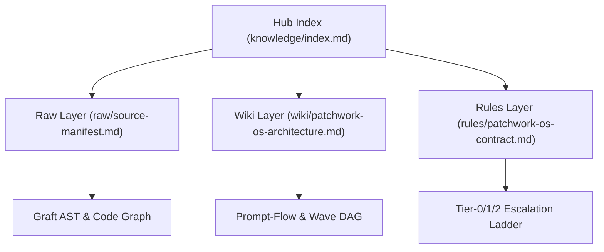

# Patchwork-OS: Open-Source Agentic Operating System

**Patchwork-OS** is a portable, host-agnostic and runtime-agnostic agentic workflow and knowledge operating system synthesized via **Synergetic Assimilation + Counterpart Limit Coverage** across 9 open-source foundations and 4 core paradigms (**Workflow**, **Meta-Prompting**, **Graph-Prompting**, and **Prompt-Flow**).

## 1. Architecture Topology

## 2. Five Pillars & Nine Open-Source Foundations

| Pillar | Open-Source Foundations | Synergetic Assimilation | Counterpart Limit Coverage |
| :--- | :--- | :--- | :--- |
| **1. Workflow Engine** | `morluto/rea`, `trailhq/Trail-Code` | Append-only event-sourced ledger + background workflow & hook execution | Wave DAG dependency gating prevents unbounded non-deterministic retry loops |
| **2. Meta-Prompting** | `NousResearch/hermes-agent`, `buildermethods/agent-os`, `mattpocock/skills` | Self-improving skill loop + Builder Methods' original `buildermethods/agent-os` product/spec standards + Wayfinder CLI scripts | Pre-execution contract templates (`KK/KU/UK/UU`) prevent spec drift and unverified mutations |
| **3. Graph-Prompting** | `graft`, `johnfkoo951/cmds-llm-wiki`, `johnfkoo951/cmds-share` | AST code graph (`skeleton`, `callers`) + CMDS 3-layer wiki (`raw/`, `wiki/`, `rules/`) | Hub-spoke pointer routing and Tier-0 deterministic validation prevent context bloat and unvetted sync |
| **4. Prompt-Flow** | `nateherkai/AIS-OS` | Role-separated multi-agent pipeline (`Composer != Validator != Synthesizer`) | Dynamic capability/quota-aware routing eliminates hardcoded model lock-in |
| **5. Lazy Hydration** | `Leonxlnx/unlazy` | Placeholder-first lazy loading and on-demand hydration | Index/skeleton-first traversal expands full source spans only when required |

## 3. Repository Layout

- `LICENSE` — MIT License with third-party open-source foundation acknowledgements
- `docs/architecture/patchwork-os-blueprint.md` — Full architectural blueprint
- `knowledge/` — CMDS 3-layer knowledge hub (`index.md`, `raw/`, `wiki/`, `rules/`)
- `src/patchwork_os/` — Host/Runtime-Agnostic Hub-Spoke Binder & Near-Deterministic 3-Tier Escalation Ladder (`Tier 0 Deterministic CLI -> Tier 1 Local LLM no-thinking -> Tier 2 Main LLM escalation`)
- `tests/` — Deterministic unit and contract verification suite

## 4. License

This project is licensed under the **MIT License** — see the [LICENSE](LICENSE) file for details.
