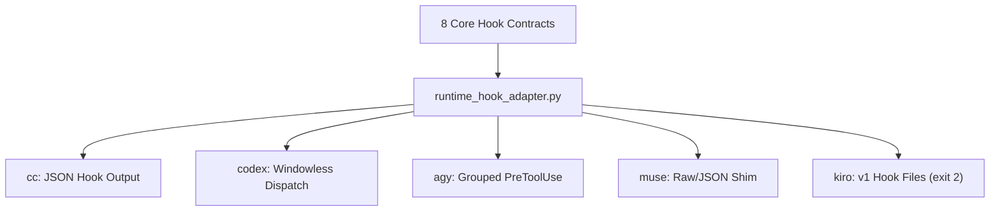

# Multi-Runtime Hook/Lint Adapter, Knowledge-Vault, Converging-Voyage, REA & Software Factory ADR

## 1. Context & Architectural Goal

Modern agentic engineering spans multiple runtime harnesses (`cc`, `codex`, `agy`, `muse`, `kiro` / `aws_kiro`), development surfaces (`cli`, `ide_extension`, `desktop_app`, `crew`), operating systems (`windows`, `wsl`, `posix`), and foundation model families (`claude`, `gpt`, `gemini`, `muse`). This document records the generalized concepts, procedures, patterns, and architectural decisions implemented in `src/patchwork_os/runtime_hook_adapter.py` so any team can independently re-implement the complete stack in a clean-room environment.

## 2. Generalized 8-Hook & 2-Config Multi-Runtime Adapter Pattern

1. **Tool Vocabulary Normalization (`CANONICAL_TOOL_VOCABULARY_MAP`)**:
   - Shell: `execute_bash` (Kiro), `run_command` (AGY), `Bash` / `PowerShell` (CC), `shell` / `exec_command` (Codex/Muse).
   - File Read: `fs_read` / `read` / `load_resource` (Kiro), `read_file` / `view_file` (AGY), `Read` (CC/Codex).
   - File Write & Edit: `fs_write` / `write` / `str_replace` (Kiro), `write_file` / `replace_file_content` (AGY), `Write` / `Edit` / `MultiEdit` (CC), `apply_patch` (Codex).
   - Directory & Search: `list_directory` / `glob` / `grep` (Kiro), `list_dir` / `find_by_name` / `grep_search` (AGY), `Glob` / `Grep` (CC/Codex).
2. **Runtime Wire-Protocol Adaptation (`format_hook_verdict`)**:
   - `kiro` (`kiro-cli`, `ide_extension`, `crew`): `PreToolUse` blocks when the hook exits with code `2` and writes the refusal reason to `stderr`; `UserPromptSubmit` injects `stdout` into `<HOOK_INSTRUCTION>`.
   - `cc`: `PreToolUse` returns `hookSpecificOutput.permissionDecision = "deny"` on `stdout` (`exit 0`).
   - `codex` & `muse`: `PreToolUse` returns `{"decision": "block", "reason": "..."}` on `stdout` (`exit 0`).
   - `agy`: `PreToolUse` returns `{"decision": "deny", "reason": "..."}` on `stdout` (`exit 0`) under grouped `[{matcher, hooks}]` entries.
3. **Eight Core Agnostic Hooks (`EIGHT_CORE_HOOK_CONTRACTS`)**:
   - `stance-consistency-hook`, `insights-reminder-hook`, `context-route-contract-hook`, `skill-auto-context-gate` (`skill-brief.json`), `voyage-map-home-guard` (`voyage-maps.json`), `model-hardcoding-gate`, `fable-governance-gate`, and `windowless-conhost-prevention-gate`.

## 3. Four Independently Re-Implementable Subsystem Blueprints

1. **Knowledge-Vault (`knowledge_vault`)**:
   - 3-layer plain-Markdown CMDS hierarchy (`raw/`, `wiki/`, `rules/`) with `index.md` progressive disclosure (`<4KB` Hop-0 index) and turn-start AST-graph + vault query-first discipline.
2. **Converging-Voyage (`converging_voyage`)**:
   - Canonical `docs/voyage/` routing, 2-stage guarded landing (`--dry-run` preflight before `--execute`), expected-old-OID atomic ref update, and HMAC-SHA256 lease token self-healing.
3. **Reverse-Engineer-Anything (`rea_reverse_engineering`)**:
   - 4-stage Forward-Reverse-Roundtrip (`FRR`) deconstruction of binaries, ASAR/VSIX/JS bundles (`acp-server.js`, `extension.js`), child-process spawn chains (`windowsHide:!0`, `CREATE_NO_WINDOW`), hook schemas (`TUo`), and clean-sandbox `.bundle`/`.zip` byte-parity verification.
4. **Software Factory (`software_factory`)**:
   - 5-wave cognitive pipeline (`Planning -> Reasoning -> Adversarial Triage -> Synthesizing/Orchestrating -> Meta-Evaluating`) with strict 5-role orthogonality (`Composer != Criticizer != Validator != Synthesizer != Meta-Evaluator`), 9-step TDD + mutation kill gate, and delivery-first anti-choke budget.
