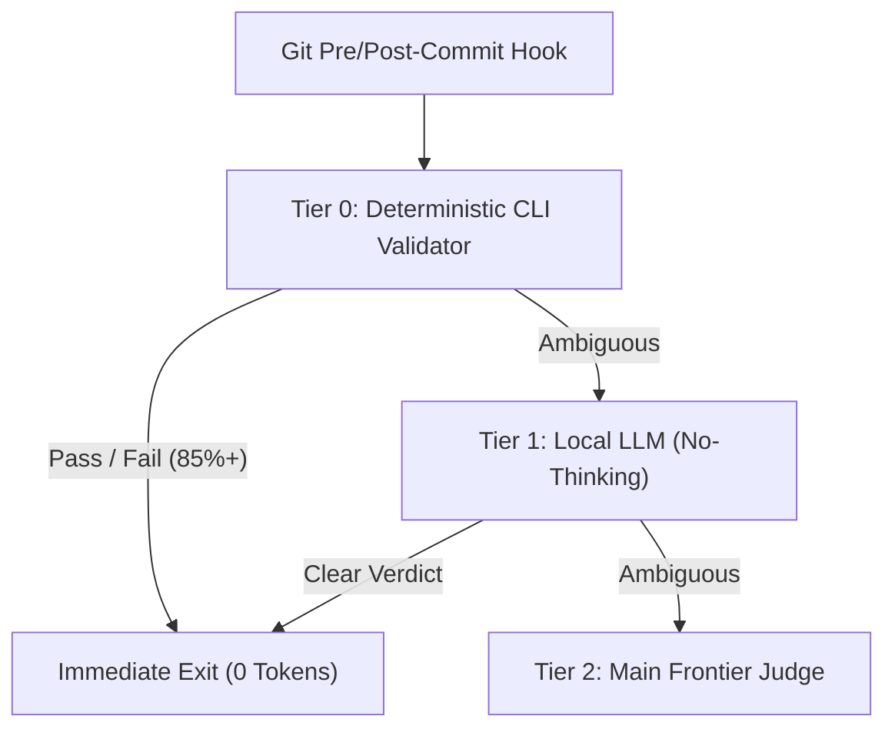

# Open-Source Patchwork-OS Architectural Blueprint

## 1. Design Thesis: Synergetic Assimilation + Counterpart Limit Coverage

Every open-source agent framework exhibits a distinct architectural strength paired with an operational blind spot when deployed in isolation. **Patchwork-OS** binds nine open-source repositories so that each project's failure mode is covered by its counterpart's deterministic boundary:

1. **Event-Sourced Workflow & Hook Execution**:
   - **Assimilated**: [`morluto/rea`](https://github.com/morluto/rea) (immutable event-sourced state) + [`trailhq/Trail-Code`](https://github.com/trailhq/Trail-Code) (background workflow hooks and isolated worktree execution).
   - **Counterpart Coverage**: Wave-ordered DAG scheduling gates every mutation on deterministic pre-commit checks.
2. **Spec-Driven Meta-Prompting & Deterministic Tooling**:
   - **Assimilated**: [`buildermethods/agent-os`](https://github.com/buildermethods/agent-os) (Builder Methods' original open-source Agent OS for structured product/spec context injection) + [`NousResearch/hermes-agent`](https://github.com/NousResearch/hermes-agent) (closed-loop skill evolution) + [`mattpocock/skills`](https://github.com/mattpocock/skills) (Wayfinder deterministic CLI helpers).
   - **Counterpart Coverage**: Structured epistemic classification (`KK/KU/UK/UU`) and forward/reverse/roundtrip (`FRR`) verification prevent spec drift.
3. **AST Graph-Prompting & 3-Layer Knowledge Wiki**:
   - **Assimilated**: `graft` (AST-first code graph: `skeleton`, `callers`, `ask --source`) + [`johnfkoo951/cmds-llm-wiki`](https://github.com/johnfkoo951/cmds-llm-wiki) (`raw/`, `wiki/`, `rules/` 3-layer markdown vault) + [`johnfkoo951/cmds-share`](https://github.com/johnfkoo951/cmds-share) (selective knowledge pack export).
   - **Counterpart Coverage**: Deterministic Tier-0 satellite validation (`validate_patchwork_satellite`) blocks credential leaks, broken links, and oversized diagrams before any share or commit.
4. **Role-Separated Prompt-Flow & Lazy Context Hydration**:
   - **Assimilated**: [`nateherkai/AIS-OS`](https://github.com/nateherkai/AIS-OS) (multi-agent prompt-flow orchestration) + [`Leonxlnx/unlazy`](https://github.com/Leonxlnx/unlazy) (placeholder-first lazy hydration).
   - **Counterpart Coverage**: Strict separation of `Composer != Validator != Synthesizer` combined with skeleton-first lazy loading keeps token consumption minimal.

## 2. Near-Deterministic 3-Tier Escalation Ladder

- **Tier 0 (Deterministic CLI)**: Validates 3-layer CMDS structure, wikilinks, secret/host hygiene, and Mermaid width (`<= 79` chars) in `< 50ms` at `0` LLM tokens.
- **Tier 1 (Local LLM No-Thinking)**: Consumes compact `{processed, raw}` JSON payloads with `thinking=False` (`temperature=0.0`) for semantic boundary checks, emitting `PASS`, `FAIL`, or `AMBIGUOUS_ESCALATE`.
- **Tier 2 (Main Frontier LLM)**: Invoked strictly when Tier 1 returns `AMBIGUOUS_ESCALATE`.
