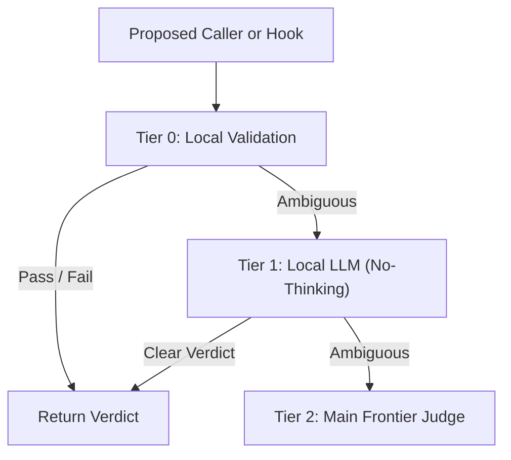

# Patchwork-OS Architectural Blueprint and Evaluation Boundary

## 1. Design Thesis: Synergetic Assimilation + Counterpart Limit Coverage

The references below preserve the design thesis of combining Workflow, Meta-Prompting, Graph-Prompting and Prompt-Flow. They are design influences, not evidence that upstream repositories are bundled, licensed for a particular company, or integrated with a live runtime. The current evaluation is a local Python library with repository-only procedure documents. Upstream provenance, company/ITAR clearance, complete isolation and signed authentication remain unverified.

1. **Event-Sourced Workflow & Hook Execution**:
   - **Assimilated**: [`morluto/rea`](https://github.com/morluto/rea) (immutable event-sourced state) + [`trailhq/Trail-Code`](https://github.com/trailhq/Trail-Code) (background workflow hooks and isolated worktree execution).
   - **Intended Counterpart Coverage**: Wave-ordered dependency gates and bounded mutations. Live workflow hooks, dispatch locks and automatic pre-commit enforcement are not established by this blueprint.
2. **Spec-Driven Meta-Prompting & Deterministic Tooling**:
   - **Assimilated**: [`buildermethods/agent-os`](https://github.com/buildermethods/agent-os) (Builder Methods' original open-source Agent OS for structured product/spec context injection) + [`NousResearch/hermes-agent`](https://github.com/NousResearch/hermes-agent) (closed-loop skill evolution) + [`mattpocock/skills`](https://github.com/mattpocock/skills) (Wayfinder deterministic CLI helpers).
   - **Intended Counterpart Coverage**: Structured knowledge classification (`KK/KU/UK/UU`) and forward/reverse/roundtrip (`FRR`) procedures make assumptions reviewable; their presence does not prove enforcement or eliminate drift.
3. **AST Graph-Prompting & 3-Layer Knowledge Wiki**:
   - **Assimilated**: `graft` (AST-first code graph: `skeleton`, `callers`, `ask --source`) + [`johnfkoo951/cmds-llm-wiki`](https://github.com/johnfkoo951/cmds-llm-wiki) (`raw/`, `wiki/`, `rules/` 3-layer markdown vault) + [`johnfkoo951/cmds-share`](https://github.com/johnfkoo951/cmds-share) (selective knowledge pack export).
   - **Intended Counterpart Coverage**: Explicit local validation APIs such as `validate_patchwork_satellite`. Their bounded checks do not prove that every leak, link error or pre-share/pre-commit path is intercepted; callers must supply and examine the actual result.
4. **Role-Separated Prompt-Flow & Lazy Context Hydration**:
   - **Assimilated**: [`nateherkai/AIS-OS`](https://github.com/nateherkai/AIS-OS) (multi-agent prompt-flow orchestration) + [`Leonxlnx/unlazy`](https://github.com/Leonxlnx/unlazy) (placeholder-first lazy hydration).
   - **Intended Counterpart Coverage**: Distinct composer/validator/synthesizer responsibilities and index-first reading. Role independence, runtime delivery and token savings need separate observations.

## 2. Three-Tier Escalation Design (Runtime Not Established)

- **Tier 0**: Local validation functions and contract data. Latency, coverage percentages and automatic hook invocation have not been established here.
- **Tier 1**: A local-model escalation design. Live model invocation and deterministic model output are unverified; no model call is part of the local evaluation.
- **Tier 2**: A frontier-model escalation design. A planned escalation is not an observed invocation or an authorization to send data.

## 3. Current Local Consumer Contract

`plan_inter_cli_dispatch` returns only a plan with `execution_supported=False` and `runtime_acceptance=not_run`. `dry_run=False` is unsupported. Tasks must be existing regular files and hashes use their actual bytes, including valid empty files. Result/lease paths and `launch_argv` are descriptors; no runnable dispatcher CLI, process creation, lock acquisition or authentication is provided by this function.

Use the [README local evaluation procedure](../../README.md) for installation, a nonsensitive API example and removal. The wheel and repository Markdown/helpers are separate resources. `.claude/settings.json` has empty evaluation defaults; the old commands/allow entries are preserved in the inactive `.claude/settings.example.json` for separate manual review. No host/global configuration or trust change is required by this profile. Rebuilt-wheel inspection, updated sample consumption, removal, egress observation, and native opt-in behavior remain acceptance work.
