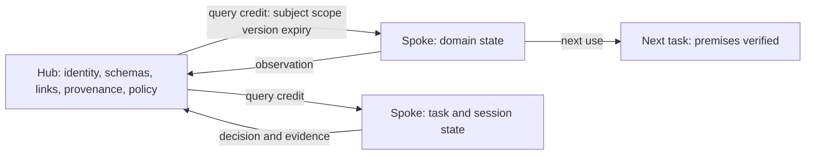
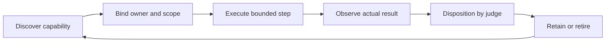

# Portable Agent Infrastructure

## Overview

Reference architecture for portable agent work without mandatory protocol
dependencies. Every adapter is reachable through command-line arguments, JSON
on standard input and output, files, a loopback HTTP port, or a direct
library call. No single runtime, model, or protocol is selected here.

The hub may be implemented as a generic LLM wiki: raw sources stay raw, a
curated wiki links them with provenance, and executable rules stay separate.
An external wiki application and its plugins are optional consumers, never
requirements.

## Knowledge Layers

Three stores never merge: raw source, curated wiki, and executable or
procedural rules. Curated nodes link to raw sources by stable identity,
provenance, version, and typed forward and reverse links. Navigation is
deterministic: explicit roots, full traversal, and a completeness report.
There is one turn-start entry point; each runtime supplies its own adapter
for it. Bounded query terms preserve filename and dotted identifiers when a
selection is made. Retrieval is scoped by prompt, task, and environment,
and query credit is bound by freshness, subject, version, and expiry.
Injection is evidence-bounded with a token budget and deduplication; any
failure or unsupported adapter reports a disposition, never text as
authority. Learning follows candidate, independent evaluation, promotion,
retrieval at next use, consumer outcome, revision, and retirement.

Worked link: a task fails on a changed input shape. The raw observation is
kept with its hash, the curated node records the applicability axes, an
independent check confirms the repair, the consumer outcome is measured,
and the next task retrieves the lesson only after verifying its premises.

## Hub and Spoke Model



### Node Types

Role, Skill, Procedure, Decision, Observation, Pattern, Task, Artifact,
RuntimeCapability.

### Directed Typed Links

uses, derived_from, validated_by, supersedes, contradicts, applies_to. Every
link carries source, scope, visibility, recorded date, and validity dates.

## Execution Feedback Loop



## Worked Generic Example

1. A task fails because an input contract changed upstream.
2. The spoke records the actual input observation with its hash.
3. The hub repairs the shared boundary and links the earlier decision.
4. An independent check confirms the new boundary.
5. The native consumer run succeeds within its declared scope.
6. A lesson candidate is retained with its evidence and validity dates.
7. The next task retrieves the lesson, verifies current premises, and only
   then reuses it.

Expected artifacts: observation record, link edit, check receipt, consumer
receipt, lesson record. Tabletop test: rerun the scenario with the consumer
step absent and require it to report not_run, never success.

## Component Ports

- Discovery: argv manifest, JSON over stdio, port listing, direct call.
- Session: lease, renew, release, expiry, reap.
- Evidence: append log, atomic replace, hash chain.
- Verification: acceptance oracle, rollback preimage, exit receipt.
- Memory hub: query, ingest, absorb, index, retire.
- Learning: observation, candidate, evaluation, promotion, revision.

## Capability Status Table

| Capability | Status |
|---|---|
| CLI argv and JSON stdio | portable |
| Loopback HTTP | portable |
| Direct library call | portable |
| Protocol remote call | optional adapter only |
| Credential references | values never stored in documents |

## Failure and Recovery

Fail closed on ambiguity. Unsupported means the port is absent. not_run means
the step did not execute. Neither is reported as success. Recovery compares
and swaps per surface, journals intent and completion per mutation, restores
in reverse order, refuses on foreign drift, and re-runs to the same result.
Multi-file atomicity is never claimed.

## Schema Sketches

```json
{
  "id": "rec/role/editable-definition/v3",
  "type": "Role",
  "version": 3,
  "hash": "sha256:example",
  "source": "role-catalog",
  "scope": "task:example",
  "visibility": "public",
  "recorded": "2026-11-15",
  "valid": "2026-11-15..2027-11-15",
  "links": [
    {"to": "rec/skill/example", "type": "uses"},
    {"to": "rec/decision/example", "type": "derived_from"}
  ]
}
```

```json
{
  "from": "rec/task/example",
  "to": "rec/observation/example",
  "type": "validated_by",
  "evidence": "sha256:example",
  "adjudicated": false
}
```

```json
{
  "type": "injection_receipt",
  "roots": ["wiki/"],
  "completeness": {"walked": 10, "excluded": 1, "errors": 0, "complete": true},
  "query_terms": ["session.jsonl", "pwa-runtime"],
  "credit_bounds": {"freshness": "2026-11-15..", "subject": "task:example",
    "version": "v3", "expiry": "2026-11-16"},
  "included": ["rec/observation/example"],
  "excluded": ["rec/stale/example"],
  "token_budget": 4000,
  "token_count": 812,
  "disposition": "injected",
  "delivery_observation": "dispatch only; consumption not_run"
}
```

A stored injection receipt proves dispatch, never consumption. Reverse links
are derived from canonical forward links and are never hand-authored.

## Record Lifecycle Example

A task record opens with owner, scope, and version. An observation link
validates the task premise. A contradiction link keeps the conflict
explicit until adjudicated. A supersedes link retires the stale version
without deleting it. Stale conclusions invalidate when newer evidence
arrives.

## Coverage Matrix

| Requested capability | Canonical skill | Public interface | Related skills | Public counterpart |
|---|---|---|---|---|
| AST, symbol, caller graph | [pwos-code-atlas](../../skills/pwos-code-atlas/SKILL.md) | index, query, snapshot | pwos-artifact-forensics | none |
| Source, binary, runtime inspection | [pwos-artifact-forensics](../../skills/pwos-artifact-forensics/SKILL.md) | inspect, hypothesize, roundtrip | pwos-code-atlas | pwos-rea |
| Factory DAG, build, review, delivery | [pwos-delivery-line](../../skills/pwos-delivery-line/SKILL.md) | plan DAG, assign, gate | pwos-plan-authoring, pwos-plan-execution | pwos-wfc |
| Query, ingest, absorb, cloud library | [pwos-memory-hub](../../skills/pwos-memory-hub/SKILL.md) | query, ingest, absorb, retire | pwos-evidence-ledger, pwos-experience-loop | none |
| Resume, realign, recap, sync | [pwos-plan-convergence](../../skills/pwos-plan-convergence/SKILL.md) | resume, realign, recap, sync | pwos-plan-authoring | pwos-quarry |
| Browser session, DOM and pixels | [pwos-browser-bridge](../../skills/pwos-browser-bridge/SKILL.md) | attach, act, readback | pwos-runtime-ports | pwos-browser-vla |
| Skill graph selection | [pwos-workflow-router](../../skills/pwos-workflow-router/SKILL.md) | select, hand off | all skills | none |
| Branch merge, stash, preimage CAS | [pwos-branch-convergence](../../skills/pwos-branch-convergence/SKILL.md) | inventory, merge, rollback | pwos-plan-execution | none |
| Local observation, judge, steering | [pwos-local-sensor](../../skills/pwos-local-sensor/SKILL.md) | cursor, observe, judge | pwos-experience-loop | none |
| Role identity separate from model | [pwos-role-catalog](../../skills/pwos-role-catalog/SKILL.md) | define, version, link | pwos-memory-hub | pwos-persona-agent |
| Lesson lifecycle | [pwos-experience-loop](../../skills/pwos-experience-loop/SKILL.md) | observe, evaluate, promote, retire | pwos-memory-hub | pwos-crucible |
| Capability discovery, launch, ACK | [pwos-runtime-ports](../../skills/pwos-runtime-ports/SKILL.md) | discover, launch, capture, ack, cleanup | pwos-session-ownership | pwos-runtime-dispatch, pwos-deploy-cli |
| Claims, hashes, contradictions | [pwos-evidence-ledger](../../skills/pwos-evidence-ledger/SKILL.md) | append, replace, link check | pwos-memory-hub | none |
| Leases, reap, expiry | [pwos-session-ownership](../../skills/pwos-session-ownership/SKILL.md) | mint, claim, renew, release, reap | pwos-runtime-ports | pwos-session-lifecycle |
| Requirements brainstorming | [pwos-design-dialogue](../../skills/pwos-design-dialogue/SKILL.md) | explore, decide, record | pwos-plan-authoring, pwos-grilling | pwos-grilling |
| Plan authoring | [pwos-plan-authoring](../../skills/pwos-plan-authoring/SKILL.md) | draft, order, bind | pwos-plan-convergence | none |
| Plan execution | [pwos-plan-execution](../../skills/pwos-plan-execution/SKILL.md) | execute, verify, receipt | pwos-delivery-line | pwos-wfc |
| Parallel dispatch | [pwos-parallel-work](../../skills/pwos-parallel-work/SKILL.md) | split, collect, join | pwos-workflow-router | none |
| Request and receive review | [pwos-change-review](../../skills/pwos-change-review/SKILL.md) | request, verify, revise | pwos-delivery-line | none |
| Verification before completion | [pwos-completion-check](../../skills/pwos-completion-check/SKILL.md) | gate, receipt, verdict | pwos-evidence-ledger | pwos-harness-audit |
| Skill authoring | [pwos-skill-authoring](../../skills/pwos-skill-authoring/SKILL.md) | draft, validate, mirror | pwos-workflow-router | none |
| Root-cause debugging | [pwos-systematic-debugging](../../skills/pwos-systematic-debugging/SKILL.md) | reproduce, hypothesize, falsify, fix | pwos-change-review, pwos-completion-check | pwos-systematic-debugging |
| Test-first build | [pwos-tdd](../../skills/pwos-tdd/SKILL.md) | test RED, implement, GREEN, mutation | pwos-change-review, pwos-completion-check | pwos-tdd |
| Terminal input and acknowledgement | [pwos-terminal-messaging](../../skills/pwos-terminal-messaging/SKILL.md) | bind, buffer readback, transcript ACK | pwos-runtime-ports, pwos-session-lifecycle | pwos-session-lifecycle |

## Revision

Version 1. Portable reference; implementation bindings remain owned by their
runtimes and are recorded per consumer, never presumed.
