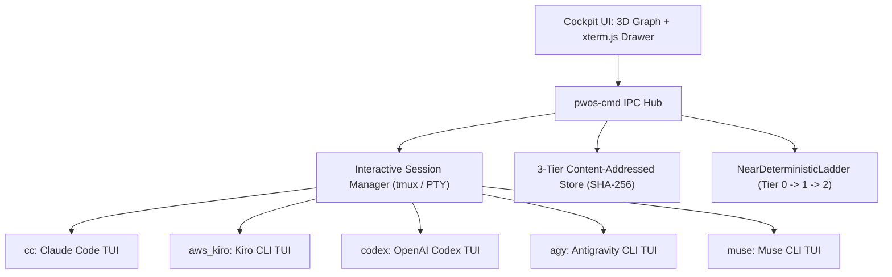
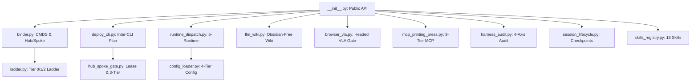

# Patchwork-OS (`PWOS-CMD-UNIV`): 3D Brain Cockpit, AST Dependency Map, and 5-Runtime Universal Playbook

## 1. Generalized 3D Brain Cockpit & `pwos-cmd` Interactive xterm.js Architecture Skeleton

This document defines the clean-room architecture skeleton for the `Patchwork-OS` 3D Brain Cockpit and the `pwos-cmd` interactive terminal session bridge (`xterm.js` <-> `tmux` / PTY). All company-specific paths, private tokens, and host bindings are excluded; compliance and runtime execution remain `unverified_example` / `not_run` until evaluated in a target environment.



### Core Interactive Drawer Capabilities (`pwos-cmd`)
1. **Per-Tab Interactive CLI Deployment (`launch_terminal_tab`)**:
   - Spawns an isolated interactive session (`pwos-cockpit-<sid>`) for the selected runtime (`cc`, `aws_kiro`, `codex`, `agy`, `muse`), model, and effort level.
2. **Real-Time Viewport Capture & Screen Classification (`capture_terminal_tab`)**:
   - Streams the live terminal viewport (`capture` + `classify`) into `#cockpit-xterm-screen` whenever the operator switches tabs or triggers `Capture`.
3. **Interactive Composer Injection & Hub/Spoke Routing (`exec_terminal_input`)**:
   - Delivers prompts and keystrokes (`Enter`, `Escape`, `C-c`) directly into the live CLI composer (`paste` + `send_key`), while supporting `hub-send`, `spoke-reply`, and `hub-inbox` across tabs with SHA-256 CAS receipts.
4. **Bounded Session Reclamation (`end_and_reclaim_session`)**:
   - Terminates the underlying interactive session (`alive == False`) and records a deterministic reclamation receipt.

---

## 2. AST Module Dependency Map (`src/patchwork_os`, `<= 79` Columns)



---

## 3. Universal 5-Runtime (`cc`, `aws_kiro`, `codex`, `agy`, `muse`) Fresh Deployment Playbook

### Step 1: Clone & Install Clean-Room Package
```bash
git clone <patchwork-os-clean-room-repo-url> patchwork-os
cd patchwork-os
python -m pip install -e .
pytest -q
```

### Step 2: Generate Interactive Questionnaire & 4-Tier Configuration
```bash
python -X utf8 -B -c "
from pathlib import Path
from patchwork_os.setup_init import initialize_patchwork_workspace
res = initialize_patchwork_workspace(Path('.'), compliance_regime='commercial_general')
print(res)
"
```

### Step 3: 5-Runtime Adapter Binding Matrix (`unverified_example`)

| Runtime Slug | CLI Binary | Interactive Launch Template | Default Surface |
| :--- | :--- | :--- | :--- |
| `cc` | `claude` | `claude --model <tier_model>` | `cli`, `ide`, `desktop_app` |
| `aws_kiro` | `kiro-cli` | `kiro-cli chat --model <tier_model>` | `cli`, `ide` |
| `codex` | `codex` | `codex --model <tier_model>` | `cli`, `ide`, `desktop_app` |
| `agy` | `agy` | `agy --model <tier_model>` | `cli`, `ide`, `desktop_app` |
| `muse` | `muse` | `muse --model <tier_model>` | `cli` |

### Step 4: Verify Tier-0 Satellite & Hygiene Invariants
```bash
python -X utf8 -B -c "
from pathlib import Path
from patchwork_os.binder import validate_patchwork_satellite
from patchwork_os.llm_wiki import audit_itar_and_obsidian_hygiene
print('Satellite:', validate_patchwork_satellite(Path('.')))
print('Hygiene:', audit_itar_and_obsidian_hygiene(Path('.')))
"
```
