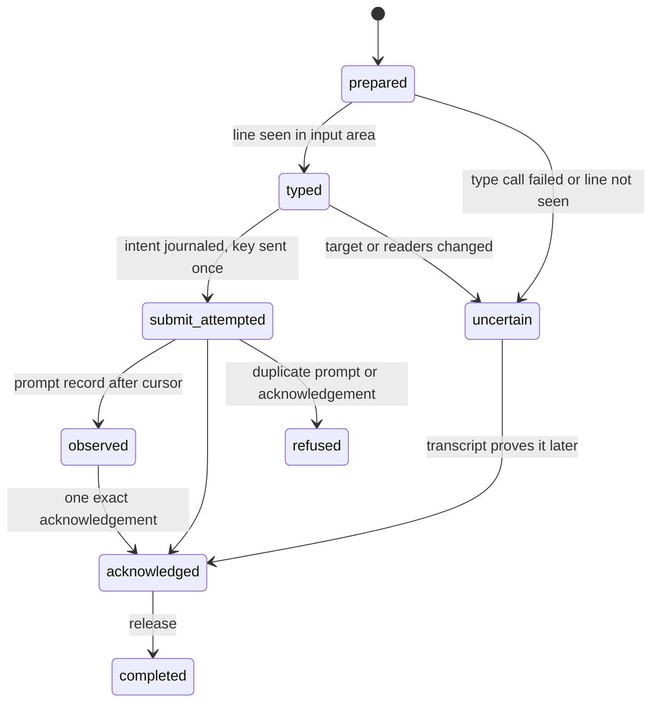

# Terminal messaging between live sessions

`patchwork_os.terminal_messaging` lets one session hand another live terminal
session a message and learn, from the recipient's own record, whether it was
consumed. It types one short pointer line, never the message body, and it
treats typing, submitting, observing and acknowledging as four separate facts.

This page describes what the module does, how to set it up for a terminal that
runs inside an editor, and what has and has not been exercised. A copy ships in
the package under `patchwork_os/resources/docs/`.

## What has been exercised

| Backend | Hosts | Target identity | Shipped adapter | Status |
| :--- | :--- | :--- | :--- | :--- |
| `owned-pipe` | Windows, Linux | pid and OS creation time | `OwnedPipeAdapter` | live on the machine that runs the tests |
| `tmux` | Linux, WSL | server socket and pane id | argv builders only | not_run |
| `managed-pty` | Windows (ConPTY), Linux | pid and OS creation time | none | not_run |
| `windows-console` | Windows | pid and OS creation time | none | not_run |
| `ide-bridge` | any | bridge-defined terminal id | none | not_run |

No vendor agent runtime and no editor terminal was started to produce this
table. The labels `cc`, `codex`, `agy`, `muse` and `kiro`, and the names of
editors, describe what a person calls a session. They never select a route.
`backend_status()` returns `unsupported` for any of them.

## One entry, four legs

`Messenger` is the single entry point. It is given four adapters, which may be
one object or four:

| Leg | Interface | Question it answers | Side effect |
| :--- | :--- | :--- | :--- |
| discovery and binding | `DiscoveryAdapter.observe_target` | Is this the same process generation or pane, on which backend, with which readers? | none |
| capture | `CaptureAdapter.capture` | What is in the input area, by its buffer and by its drawn rows? Is a dialog in the way? | none |
| input | `InputAdapter.type_text`, `submit` | Write this text. Separately, submit it. | yes |
| acknowledgement | `AcknowledgementAdapter.pin`, `read_after` | What did the recipient record after the pinned position? | none |

Capture and input are different interfaces on purpose. A capture adapter can be
granted to something that must never be able to type.

## Envelope

`create_envelope` writes the payload file once and returns an `Envelope`:

- protocol version `pwtm/1` and a unique message id;
- source and target session ids, which must differ;
- the target identity: either a pid with its OS creation time, or a multiplexer
  server with a pane id, plus the backend and host it was observed on;
- a payload reference: path, SHA-256 and size of an immutable UTF-8 file;
- the exact acknowledgement token, stored inside the payload;
- an expiry time.

The typed line is `PWTM1 <message id> sha256:<digest> <payload path>`. The
acknowledgement the recipient must record is
`ACK <token> id=<message id> sha256=<digest>`. The token is not in the typed
line, so a recipient can produce the exact acknowledgement only by opening the
payload.

The digest proves the payload was not changed. It does not prove who sent the
message and it authorizes nothing. Authority to send stays with the caller.

## States



- `prepared`: the journal exists and the transcript position is pinned. Nothing
  has touched the target.
- `typed`: the whole input area was seen to be the prompt followed by exactly
  the line.
- `submit_attempted`: the submit intent is in the journal. Whether the key
  landed is unknown.
- `observed`: the recipient's transcript holds the line as its own input, after
  the pinned position.
- `acknowledged`: exactly one exact acknowledgement follows that record.
- `completed`: the caller released the message after the acknowledgement.
- `refused`: a final refusal, for example a duplicate acknowledgement.
- `uncertain`: a side effect may have happened and could not be confirmed.

An emptied input area, a returned call and exit code 0 are not states. None of
them moves a message forward.

## Journal and reentry

Each message has an append-only journal. The row `intent_type` is written and
flushed before any text is written, and `intent_submit` before the submit key.
If the sender stops between an intent and its effect, the journal says the
effect may have happened.

`deliver` types and submits at most once per message. Called again on the same
message it only observes. `resume` only observes. Nothing in the module sends a
second submit key. A message stuck in `submit_attempted` stays there until the
recipient's transcript settles it or a person does.

## Acknowledgement rules

- The transcript position is pinned at `prepare`. Records before it are never
  read, so an older identical acknowledgement cannot count.
- The cursor stores digests of the bytes before it and the file identity. A
  shorter file (`TRANSCRIPT_TRUNCATED`), changed earlier bytes
  (`TRANSCRIPT_PREFIX_DRIFT`) or a different file under the same name
  (`TRANSCRIPT_ROTATED`) invalidates it for good. A message whose cursor is
  invalid can no longer be promoted by this journal.
- An acknowledgement counts when its role is the recipient's, its session is
  the target session, its text is exactly the expected text, and it follows the
  prompt record. Every near miss is returned with its reason.
- Two prompt records or two exact acknowledgements close the message as
  `refused`. A duplicate is evidence that something was delivered twice.
- A line that ends without a newline is not parsed until it is complete.

## Before typing and before submitting

Before any text is written `Messenger` requires: an unexpired envelope, a
payload that still matches its digest, a live target whose observed identity
equals the envelope's, a known backend that the input adapter supports, a known
screen, no dialog, the input buffer itself, and an input area proven to be
exactly the prompt. An observation that does not carry the buffer is refused
with `COMPOSER_UNVERIFIABLE`, however empty its rows and cursor look.

After typing and before the submit key it observes again: the same identity,
the same backend, the same set of readers, and an input area that is still
exactly the prompt and the line. Any difference ends in `uncertain` with the
line left in place and no key sent. The sender does not clear text it cannot
account for, and it does not type into a draft that is not its own.

## What proves the input area: the buffer, cross-checked by rows

A terminal pads every row with blanks. A draft made only of spaces, or a space
someone added after a line, draws exactly the same rows as an empty or exact
input area. Rows therefore never prove emptiness or exactness on their own.

The cursor does not prove it either. Someone can type spaces and move the caret
back to the start: the rows look empty and the cursor sits exactly where an
empty input area would put it, while the buffer holds spaces.

The only authority is `composer_text`, the exact contents of the input buffer.
`screen_shows_exactly` requires the buffer to equal the text and every drawn
row to equal the row the text should occupy by display cells. It does not
search for a substring and does not strip whitespace, so a foreign draft that
merely contains the line is not accepted.

`cursor_cells` may be supplied as supplementary information. It never decides
anything. `composer_evidence` names what an observation carries (`buffer`,
`cursor` or `none`), and anything other than `buffer` is refused with
`COMPOSER_UNVERIFIABLE` before any text is written. A backend that can report
rows and a cursor but not its input buffer is therefore not usable yet.

Limits to know:

- A typeable line may not start or end with whitespace or contain control
  characters, so the line itself never depends on invisible cells.
- Cell widths follow the Unicode East Asian Width property, with zero width for
  combining and format characters. A terminal that draws a character at a
  different width will not match, and the result is `uncertain`, not a guess.

## Two controllers

Two senders can reach the same target, or the same message can be driven from
two places. `Messenger` uses two lock files with a bounded wait:

- a message lock, held for every call that writes a journal row, so the rows of
  one message are written by one controller at a time;
- a target lock, keyed by the process or pane itself, held from the checks
  before typing until the submit key has been sent, so two controllers cannot
  both pass the checks and type into one target.

A controller that cannot take a lock within `lock_wait` is refused with
`MESSAGE_LOCK_BUSY` or `TARGET_LOCK_BUSY` and has typed nothing. Controllers
that may address the same target must share one lock directory; by default it
sits inside the journal directory.

The locks exclude live controllers from each other. They are not atomic across
a crash: a controller that dies inside the section leaves its lock file, later
attempts are refused, and the file records the owner's pid and creation time
for the person who decides whether to remove it. Nothing removes it
automatically, and the journal, not the lock, still decides whether a side
effect may have happened.

## Relationship to `session_lifecycle`

`patchwork_os.session_lifecycle` already exports
`create_session_messenger_envelope` and `verify_session_messenger_ack`. They are
unchanged. They describe a message and compare an observed digest and recipient
with it; they do not locate a terminal, type, or read a transcript. This module
is the transport those descriptions lacked: it finds one target, writes one
line, and obtains the observation from the recipient's transcript. The two
envelope shapes are separate. Code that only needs to record that a peer
acknowledged a digest can keep using the earlier functions.

## Busy targets and slow rendering

Waiting is bounded observation: poll, compare, stop at a limit. The limits in
`ObservationPolicy` belong to the caller and to one adapter. There is no
universal settle time.

`LatencyBook` records how long each phase took and whether it was seen or timed
out, and `suggest()` returns a larger wait derived from what was seen. A
suggestion is never applied by the module, and no failure widens a permission.

## Capture privacy and cleanup

A capture can contain whatever the recipient had on screen. The module keeps
captures in memory only and writes none of them to the journal. The journal
holds event names, codes, offsets, wait times and a digest of the typed line.

The caller owns the payload directory and the journal directory. Payload files
are created once and marked read-only. Delete a payload with `remove_payload`
after its message is `completed` or abandoned; on Windows a read-only file also
blocks deleting its directory. Keep the journal for as long as a duplicate send
would matter. An adapter that saves captures to disk must say where and remove
them when the message closes.

## Setting up a terminal that runs inside an editor

This applies to a terminal opened inside Kiro IDE, VS Code or Antigravity IDE.
None of these integrations has been measured here. The procedure is how to find
out which backend you actually have.

1. Do not start from the editor's name. Ask what owns the terminal's input.
2. If you started a multiplexer in that terminal and the recipient runs in one
   of its panes, the backend is `tmux`. Identity is the server socket and the
   pane id. Inside WSL this is a Linux identity, even when the editor is a
   Windows program.
3. If your own supervisor process created the pseudo terminal and holds its
   controlling end, the backend is `managed-pty`. Identity is the child pid and
   its creation time. `patchwork_os.terminal` shows a supervisor of that kind.
4. If the editor created the terminal, the editor's terminal host owns the
   pseudo terminal. A Windows console attach by pid is not known to reach that
   terminal's input and must not be assumed. Without a bridge inside the editor
   that exposes capture, input and a transcript for that one terminal, the
   backend is `unknown` and the route is unsupported.
5. Whatever the backend, the recipient needs a transcript you may read. No
   transcript, no acknowledgement leg, no delivery claim.
6. Write the adapter for the backend you found, run the adversarial tests
   against it, and record the result as measured for that backend, host and
   editor version only.

Never use window focus or a global keyboard route. Input goes to an identified
target through an API that takes the text as data.

### Windows executables started from WSL

A Windows program launched from a WSL shell is a Windows process. Its pid and
creation time are Windows values, and Linux tools inside WSL do not see it as a
Linux process. Record such a target with host `wsl-windows-executable` and take
its identity from Windows. A Linux program in WSL has host `wsl-linux` and a
Linux identity. Mixing the two makes a generation check meaningless.

## Input is data

`InputAdapter` receives text and writes it. `OwnedPipeAdapter` writes bytes to
a pipe. The `tmux` helpers return argv lists in which the whole text is one
element after `-l --`; nothing passes through a shell. Shell metacharacters in
a payload path are therefore inert, and the tests send some to prove it.

## Try it

```text
python examples/terminal_messaging_local.py --workspace ../patchwork-messaging-demo
python -m pytest tests/test_terminal_messaging.py
```

The example starts `examples/terminal_messaging_consumer.py` as a real child
process, delivers one message, and accepts only the exact acknowledgement found
in the child's own transcript. It prints a JSON object with `"status":
"passed"`, the journal events in order, and two empty lists naming the vendor
runtimes and editor terminals it exercised.

## Strengths and their limits

| What you get | What it does not give you |
| :--- | :--- |
| The input leg can show that text reached the input area. | Only the recipient's transcript shows that it was consumed. |
| The local tests exercise the state machine against hostile sequences. | They establish nothing about any editor's terminal or any vendor runtime. |
| Tests named `test_live_*` use a real process with independent rendering. | That process is a small example, not an agent with a busy screen. |
| The journal prevents a second submit after an uncertain one. | This is at-most-once on the input side. A message can be lost and must then be handled by a person. It is not exactly-once delivery. |
| An exact acknowledgement requires opening the payload. | It shows the payload was opened, not that the requested work was done. |
| The cursor detects truncation, changed history and file replacement. | On a filesystem that reports no file identity, a replacement with an identical prefix cannot be seen. |
| The input buffer catches drafts that rows and a cursor cannot show. | An adapter without the buffer is refused; that route needs a way to read the buffer first. |
| Lock files keep two live controllers from typing into one target. | They do not survive a crash cleanly and are never broken automatically; a person clears a leftover lock. |

## References

These are the public interfaces an adapter for each backend would build on.
None of them was called to produce the results on this page except the Python
standard library.

- Python `subprocess`: https://docs.python.org/3/library/subprocess.html
- Python `pty`: https://docs.python.org/3/library/pty.html
- Windows pseudo console: https://learn.microsoft.com/windows/console/creating-a-pseudoconsole-session
- Windows `AttachConsole`: https://learn.microsoft.com/windows/console/attachconsole
- Windows `WriteConsoleInput`: https://learn.microsoft.com/windows/console/writeconsoleinput
- Windows `GetProcessTimes`: https://learn.microsoft.com/windows/win32/api/processthreadsapi/nf-processthreadsapi-getprocesstimes
- Linux `/proc/pid/stat` start time: https://man7.org/linux/man-pages/man5/proc_pid_stat.5.html
- tmux `send-keys` and `capture-pane`: https://man.openbsd.org/tmux.1
- VS Code terminal API: https://code.visualstudio.com/api/references/vscode-api#Terminal
- Unicode East Asian Width: https://www.unicode.org/reports/tr11/
