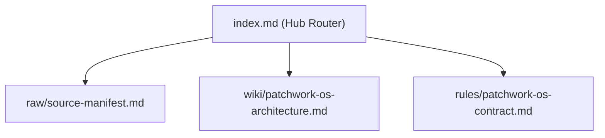

# Patchwork-OS Knowledge Hub (`index.md`)

This hub routes agents across the 3-layer CMDS knowledge architecture using lazy pointer hydration (`Leonxlnx/unlazy` pattern). Read this index first and hydrate individual spokes only on demand.

## Spoke Directory

- **Raw Layer (Immutable Source Manifest)**: [[raw/source-manifest.md]]
- **Wiki Layer (5-Pillar Hybrid Synthesis)**: [[wiki/patchwork-os-architecture.md]]
- **Rules Layer (Deterministic Contracts & Hygiene Gates)**: [[rules/patchwork-os-contract.md]]
