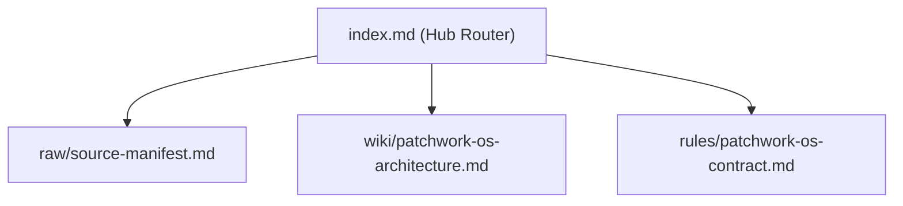

# Patchwork-OS Repository Knowledge Hub

- **Project license**: Apache-2.0 ([`../LICENSE`](../LICENSE), [`../NOTICE`](../NOTICE)); [`../THIRD_PARTY_NOTICES.md`](../THIRD_PARTY_NOTICES.md) records the design references and their licenses as observed on 2026-11-03. It is not company approval.

This hub routes agents across the 3-layer CMDS knowledge architecture using lazy pointer hydration (`Leonxlnx/unlazy` pattern). Read this index first and hydrate individual spokes only on demand.

This is a repository document, not a wheel resource or an enabled runtime hook. The local Python evaluation, installation and removal procedure is in [../README.md](../README.md). Architecture and skill documents describe intended workflows; they do not prove that external agents, model calls, enforcement or signed authentication have run.

## Spoke Directory

- **Raw Layer (Immutable Source Manifest)**: [raw/source-manifest.md](raw/source-manifest.md)
- **Wiki Layer (5-Pillar Hybrid Synthesis)**: [wiki/patchwork-os-architecture.md](wiki/patchwork-os-architecture.md)
- **Rules Layer (Deterministic Contracts & Hygiene Gates)**: [rules/patchwork-os-contract.md](rules/patchwork-os-contract.md)
- [skills/INDEX.md](../skills/INDEX.md) — Canonical inventory of the 18 procedure skeletons present in this repository; Markdown resources are not included in the observed wheel.
