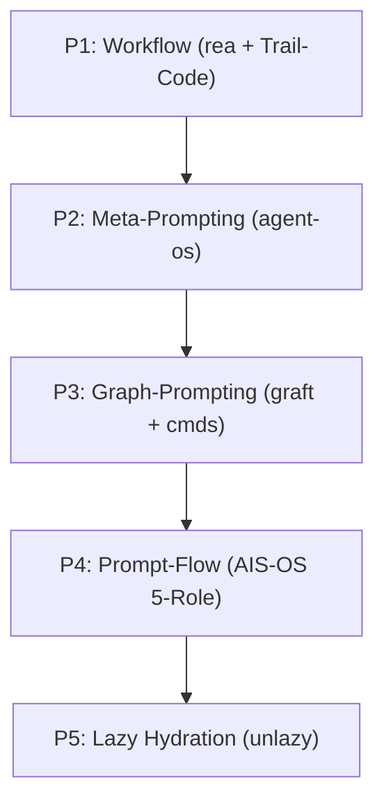

# Wiki Layer: 5-Pillar Hybrid Architecture & 5-Role Tessellation

Synthesized from [raw/source-manifest.md](../raw/source-manifest.md) and governed by [rules/patchwork-os-contract.md](../rules/patchwork-os-contract.md).

This is a design synthesis. The rules layer also records intended requirements; neither document proves installed enforcement, upstream provenance, live dispatch or company authorization.

## 1. Pillar 1 — Workflow Engine (`morluto/rea` + `trailhq/Trail-Code`)
Intends to combine event-log and worktree-hook patterns with tessellation plans (`build_tessellation_plan`). `pwos-deploy-cli` / `deploy_cli.py` currently provides plan and hash/path-contract helpers, not a live launcher or hook installation.

## 2. Pillar 2 — Meta-Prompting (`NousResearch/hermes-agent` + `buildermethods/agent-os` + `mattpocock/skills`)
Unites Builder Methods' original open-source `buildermethods/agent-os` specification standards and EARS 3-stage spec contracts (`requirements.md -> design.md -> tasks.md`, `validate_ears_spec_bundle`) with Hermes skill evolution, Wayfinder deterministic CLI wrappers, and the Generalized Starter-Boost-Kit Persona-Agent System (`pwos-persona-agent` / `persona_setup.py`) driven by brainstorming skills (`pwos-grilling`, `pwos-quarry`, `pwos-deconstruct`, `pwos-crucible`).

## 3. Pillar 3 — Graph-Prompting (`graft` + `johnfkoo951/cmds-llm-wiki` + `johnfkoo951/cmds-share`)
Pairs AST code-graph navigation (`skeleton`, `callers`) with the 3-layer CMDS knowledge hierarchy (`raw/`, `wiki/`, `rules/`) and 3-Tier OS-Agnostic Hub-Spoke projection (`SYMLINK -> NTFS_JUNCTION/HARDLINK -> ATOMIC_COPY_FALLBACK`).

## 4. Pillar 4 — Prompt-Flow (`nateherkai/AIS-OS`)
Intends five distinct roles and diff-bound records. `verify_five_role_orthogonality` and `verify_task_contract_template` check supplied data; they do not prove independent live seats. HMAC token generation/verification requires an explicit non-public caller-managed secret and retains a 16-hex tag. Key management, replay prevention and authorization are not implemented. Example model/backend/cost routing is unverified configuration data, not a compliance or availability verdict.

## 5. Pillar 5 — Lazy Context Hydration & Zero-Thinking Gate (`Leonxlnx/unlazy`)
Loads compact hub indices and `<4KB` `{processed_ast_delta, processed_lint_errors, raw_diff_excerpt}` payloads first (`evaluate_zero_thinking_gate`), resolving deterministic AST/lint checks at `0` tokens and escalating only `AMBIGUOUS` deltas to targeted counterpart roles.
