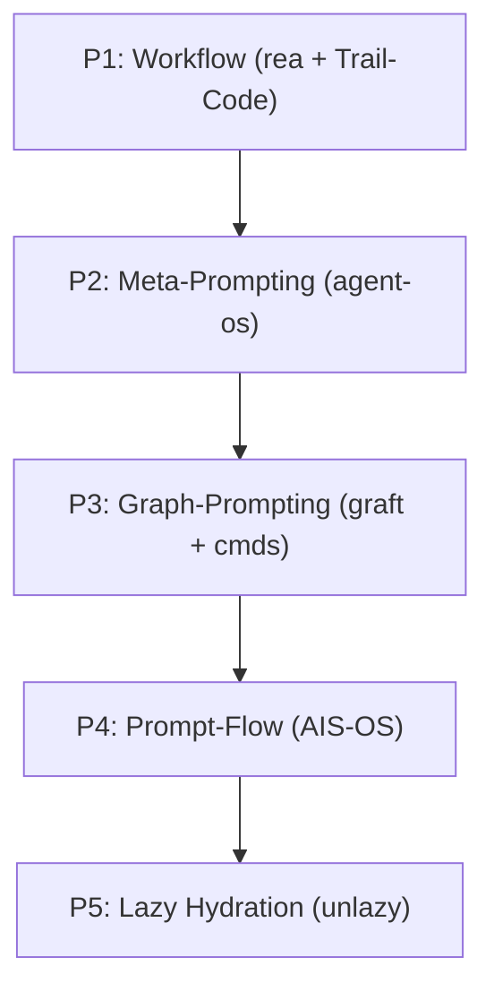

# Wiki Layer: 5-Pillar Hybrid Architecture

Synthesized from [raw/source-manifest.md](../raw/source-manifest.md) and governed by [rules/patchwork-os-contract.md](../rules/patchwork-os-contract.md).

## 1. Pillar 1 — Workflow Engine (`morluto/rea` + `trailhq/Trail-Code`)
Combines immutable event-sourced execution logs with isolated git worktree hooks. Counterpart wave-DAG scheduling prevents cyclic retries.

## 2. Pillar 2 — Meta-Prompting (`NousResearch/hermes-agent` + `buildermethods/agent-os` + `mattpocock/skills`)
Unites Builder Methods' original open-source `buildermethods/agent-os` specification standards with Hermes skill evolution and Wayfinder deterministic CLI wrappers.

## 3. Pillar 3 — Graph-Prompting (`graft` + `johnfkoo951/cmds-llm-wiki` + `johnfkoo951/cmds-share`)
Pairs AST code-graph navigation (`skeleton`, `callers`) with the 3-layer CMDS knowledge hierarchy (`raw/`, `wiki/`, `rules/`).

## 4. Pillar 4 — Prompt-Flow (`nateherkai/AIS-OS`)
Enforces strict role separation (`Composer != Validator != Synthesizer`) across multi-agent verification pipelines.

## 5. Pillar 5 — Lazy Context Hydration (`Leonxlnx/unlazy`)
Loads compact hub indices and AST skeletons first, hydrating full document or code bodies only when required by the active task contract.
